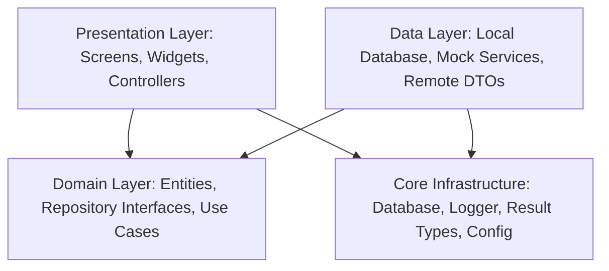

# System Architecture & Technical Specifications

> **Application**: Call Assistant & Visual Voicemail  
> **Target OS**: Android (Phones, Foldables, Tablets)  
> **Author & Creator**: Danish K ([https://danishk.web.app](https://danishk.web.app))  
> **Design Language**: Google Material 3 (Material You Dynamic Theming)

---

## 1. Architectural Philosophy & Overview

The application is engineered according to enterprise-grade **Clean Architecture** and **Feature-First** modularization principles. It is structured to Google's first-party design standards (Google Phone, Google Messages, Google Keep), emphasizing predictability, testability, high-frame-rate rendering, accessibility (TalkBack 48dp targets), and strict privacy boundaries.

All external dependencies—including telephony services, cellular MMI forwarding, audio playback/recording, speech-to-text transcription, and cloud backend relays—are isolated behind clean abstract interfaces. This decoupling ensures the entire application runs natively in an offline, zero-backend demo mode with realistic mock implementations, while allowing seamless transition to production backend microservices.



---

## 2. Directory & Package Structure

```
lib/
├── main.dart                       # Application entry point & startup bootstrap
├── app/                            # Global app composition & wiring
│   ├── app.dart                    # Root MaterialApp with DynamicColorBuilder
│   ├── config/                     # Single source of truth config & validator
│   │   ├── app_config.dart         # Central AppConfig class with TODO_UPDATE placeholders
│   │   ├── config_validator.dart   # Build-time and runtime release validator
│   │   └── flavor_config.dart      # Multi-flavor runtime configuration (dev, staging, prod)
│   └── router/                     # Declarative GoRouter navigation shell
│       ├── app_nav_shell.dart      # Adaptive scaffold (NavigationBar vs NavigationRail)
│       └── app_router.dart         # Guarded routing table & deep links
├── core/                           # Shared infrastructure & utilities
│   ├── constants/                  # Route constants, storage keys, timings
│   ├── database/                   # SQLite database engine & migrations
│   ├── errors/                     # Strongly-typed AppFailure hierarchy
│   ├── logging/                    # Rotating privacy-redacted diagnostic logger
│   └── result/                     # Functional Result<T, E> monad (Success/Failure)
├── design_system/                  # Material 3 Design System & Tokens
│   ├── components/                 # Reusable enterprise UI widgets (AppScaffold, Cards, Tiles)
│   ├── gallery/                    # Living component gallery & design catalog
│   ├── theme/                      # Light and dark Material 3 themes & color schemes
│   └── tokens/                     # Shape, typography, spacing, and elevation tokens
├── data/                           # Data layer implementations
│   ├── mock/                       # Realistic seed data (20 multi-lingual voicemails)
│   └── repositories/               # SQLite and Fake repository implementations
├── domain/                         # Core business domain contracts
│   ├── entities/                   # Business domain entities
│   └── repositories/               # Abstract repository contracts (VoicemailRepository)
├── features/                       # Modular feature domains
│   ├── about/                      # About screen, version info, open-source licenses
│   ├── call_modes/                 # Call handling modes & auto-messaging screen
│   ├── diagnostics/                # Decision trail audit log & telemetry
│   ├── feedback/                   # In-app rating & log attachment feedback
│   ├── greetings/                  # Greeting studio, variables, TTS preview
│   ├── legal/                      # Legal Hub & markdown template rendering engine
│   ├── onboarding/                 # Splash, 3-page intro, consent, rationale, setup wizard
│   ├── reliability/                # Health checks, permission validation, fix intents
│   ├── settings/                   # User account, carrier/region editor, local backup
│   └── voicemail/                  # Voicemail inbox, filters, audio player, transcript
└── l10n/                           # Internationalization & ARB files
```

---

## 3. Abstract Service Contracts & Pluggable Architecture

All hardware, telephony, and AI services are defined as abstract interfaces. In production, concrete implementations interact with Android telephony APIs or backend relays; in demo mode, mock implementations provide realistic simulated behavior.

| Abstract Interface | Purpose | Fake / Mock Implementation | Production Path |
|--------------------|---------|----------------------------|-----------------|
| `VoicemailRepository` | CRUD for voicemail inbox and transcripts | `FakeVoicemailRepository` | `LocalVoicemailRepository` (SQLite) + Cloud Sync |
| `CallModeService` | Active call-handling mode state machine | `FakeCallModeService` | Android `TelecomManager` / InCallService |
| `ForwardingService` | Carrier MMI forwarding code dispatcher | `FakeForwardingService` | Android Intent `ACTION_CALL` (`tel:*67*...#`) |
| `GreetingTtsService` | TTS speech synthesis & audio recording | `FakeGreetingTtsService` | `flutter_tts` & `record` engine |
| `DeviceHealthService`| Permissions & battery optimization audit | `DeviceHealthService` | `permission_handler` + `battery_plus` |
| `RegionRulesService` | Country emergency numbers & privacy rules | `RegionRulesService` | Static embedded regional policy engine |

---

## 4. State Management & Navigation Shell

- **State Management**: Powered by `flutter_riverpod` (v2.6+). Controllers inherit from `StateNotifier<T>`, emitting immutable state updates. No silent try-catches are permitted; all errors are wrapped in functional `Result<T, AppFailure>` types.
- **Adaptive Shell**: Automatically pivots between a bottom `NavigationBar` (compact screens / phones) and a vertical `NavigationRail` (medium & large screens / foldables / tablets), maintaining 100% feature parity across form factors.
- **Declarative Routing**: Managed through `go_router` (v14+). Supports guarded route transitions:
  1. `SplashScreen`: Evaluates persistent onboarding flags.
  2. `OnboardingScreen` -> `ConsentScreen` -> `PermissionRationaleScreen` -> `SetupWizardScreen`.
  3. Main Tab Shell: Voicemail, Modes, Greetings, Settings.

---

## 5. Security, Privacy & Local Data Sovereignty

1. **Zero Permanent Cloud Storage**: Voicemail recordings, metadata, and transcripts reside entirely within the app's sandboxed SQLite database.
2. **Privacy-Redacted Telemetry**: The built-in `AppLogger` automatically redacts sensitive caller numbers and names, hashing personal identifiers before writing to rotating log files.
3. **Screen Capture Protection**: Configurable flag in Settings allows enforcing `FLAG_SECURE` to block screenshots and screen recordings across confidential voicemail screens.
4. **Automated Data Purge**: Background worker supports automated data retention periods (7 days, 30 days, 90 days, or indefinite), securely deleting local audio files and database rows upon expiration.

---

## 6. Build Flavors & Configuration Enforcement

The application uses three distinct build flavors:
- **`dev`**: Developer and QA sandbox. Enables verbose debug logging, offline mocks by default, and relaxed configuration validation.
- **`staging`**: Pre-production validation environment.
- **`prod`**: Production distribution build.

The release pipeline executes `ConfigValidator.validate(flavor: Flavor.prod)`. Any residual `TODO_UPDATE` tokens, default placeholder names, or `example.com` domains halt the compilation immediately, guaranteeing that no unconfigured code reaches the Google Play Store.
